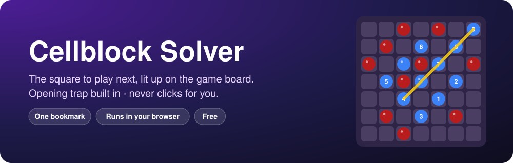
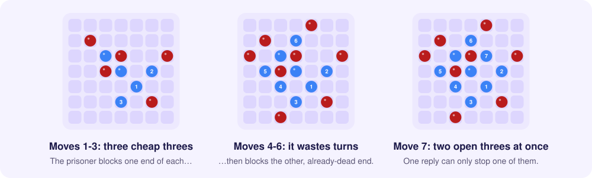
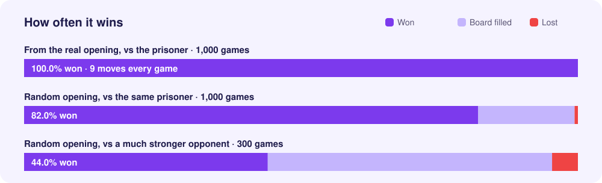
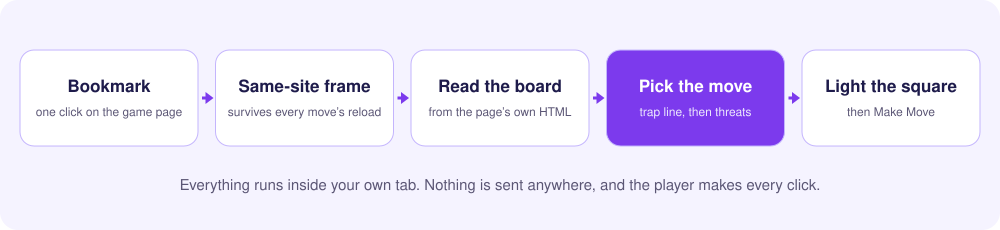

  

  

  <a href="#how-to-use">How to use</a>
  &nbsp;·&nbsp; <a href="#how-it-picks-a-move">How it works</a>
  &nbsp;·&nbsp; <a href="#how-well-it-plays">How well it plays</a>
  &nbsp;·&nbsp; <a href="#how-its-built">How it's built</a>
  &nbsp;·&nbsp; <a href="#more-neopets-solvers">More solvers</a>

---

**Cellblock Solver** shows you the square to play next in Neopets Cellblock (five in a row
against the Darigan prisoners), right on the game board, with the reason in plain words. It's
one bookmark. Every move is worked out in your own browser, nothing is sent anywhere, and it
never clicks for you.

<picture><source media="(prefers-color-scheme: dark)" srcset="docs/divider-dark.svg"></picture>

<h1 align="center">⚙️ Under the hood</h1>

<i>How to use it · how it picks a move · how well it plays · how it's built</i>

---

## How to use

| | Step | What you do |
|:-:|---|---|
| **1** | **Add the bookmark** | Open the [solver page](https://fang89.github.io/Neopets-cellblock-solver/) and drag the purple **Cellblock Helper** button to your bookmarks bar (favorites bar in Edge). No bar? <kbd>Ctrl</kbd>+<kbd>Shift</kbd>+<kbd>B</kbd>, or <kbd>⌘</kbd>+<kbd>Shift</kbd>+<kbd>B</kbd> on a Mac. |
| **2** | **Open the game** | Go to Cellblock on neopets.com and continue or start a game. |
| **3** | **Click the bookmark once** | The square to play glows purple with a label pointing at it. Click it, then press **Make Move**. It keeps working after every move and every game until you close the tab. |

| On the board | Meaning |
|:-:|---|
| 🟪 *pulsing* | **Play here.** The card in the corner says why. |
| 🟩 **Make Move** | You picked the right square. Press Make Move. |
| 🟥 *dashed* | You picked a different square. Click the purple one instead. |

> **After a win,** press **Next game of the match** on the card. The game's own **Play Again**
> button starts the match over from the first game.

The card's **×** puts the page back to normal. Works in Chrome, Edge and Firefox, on Windows
and Mac.

> The helper only lights up squares. It never clicks for you and never sends anything.

<picture><source media="(prefers-color-scheme: dark)" srcset="docs/divider-dark.svg"></picture>

## How it picks a move

### 1 · The opening trap

The early tournaments always start from the same four stones in the middle: yours on one
diagonal of a 2 × 2 block, the prisoner's on the other. The prisoner has a habit you can use.
It blocks one end of every open three, and when you then play somewhere quiet, it spends its
next turn blocking the *other* end of the three it already killed.

The helper plays a fixed 7-move line that turns those wasted turns into a double open three
on move 7. One reply can only stop one of them. The board is checked against the line before
every move, in all 8 rotations and mirror images, so it works whichever way round the start
is. The moment the prisoner does something else, the helper drops the line for the rest of
the game and goes to step 2.

### 2 · Threats, most urgent first

| Order | What it looks for | Card says |
|:-:|---|---|
| 1 | A square that makes your five | *This makes five in a row* |
| 2 | A square where the prisoner makes five next turn | *Block* |
| 3 | A straight four (two ways to make five) | *You win next turn whatever they do* |
| 4 | A chain of fours that forces a win, several moves deep | *Starts a chain of fours* |
| 5 | The prisoner's open three, before it becomes a straight four | *Stop the prisoner's open three* |
| 6 | Two threats on different lines that no single block covers, checked against every reply | *Double threat* |
| 7 | The square that would give the prisoner a double threat | *Take the prisoner's double-threat square* |
| 8 | Otherwise: the square that grows your lines most, checked one move ahead | *Grow your strongest line* |

For step 8, every 5-square stretch through a square that the prisoner hasn't blocked scores
more the more of your stones it holds. The same is counted for the prisoner (blocking is worth
almost as much as building). The top ten squares are then tried one move ahead: a move that
hands the prisoner a strong reply loses points, a move that sets up your own next threat gains
some.

<picture><source media="(prefers-color-scheme: dark)" srcset="docs/divider-dark.svg"></picture>

## How well it plays

These are simulated games on a 10 × 10 board (`docs/bench.mjs`), not games on Neopets.

- **From the real opening**, against a stand-in prisoner that makes five when it can, blocks
  fours and threes and otherwise plays at random: the trap wins every game, in 9 moves.
- **From a random opening** (two random stones each, so the trap can't run), the same prisoner
  loses 82% of games and wins 0.6%. Most of the rest fill the board.
- **Against a much stronger opponent** (the helper's own move picker, playing the prisoner's
  side), it still wins 44% and loses 4.7%.

The move picker is a line-by-line port of a Python player that beat the real prisoners on
Neopets. In the tests, the JavaScript picks the same square as the Python on 302 saved
positions, and the trap line is checked in every rotation with every order of prisoner
replies (512 lines, all won). The slowest move took about 50 ms.

<picture><source media="(prefers-color-scheme: dark)" srcset="docs/divider-dark.svg"></picture>

## How it's built

| Part | Language | Size |
|---|---|---|
| **Move picker**: board reader, opening trap, threat search | **JavaScript**, no libraries | ~420 lines |
| **Bookmark**: frame, corner card, highlights | JavaScript bookmarklet | ~210 lines |
| **Solver page**: set-up steps, a demo game played live | HTML + CSS + JavaScript | ~270 lines |
| **Build**: inlines everything into one page | Bash + Python | |
| **Tests**: same moves as the Python player, every trap line, the bookmark on a stand-in game page (never the real site) | Node + Python + Playwright | ~380 lines |

**Why a frame.** Every Make Move reloads the game page, which would wipe out an ordinary
bookmark after one move. So one click wraps the game in a full-page frame from the same
site, and the helper lives in the page around it. Each time the frame loads, it reads the
board again, picks the move and repaints. Because the frame is the same site, the helper can
read it directly: no extension, no permissions.

**Reading the board.** Everything comes from the game page's own HTML: the playable squares,
the two kinds of shield, and the level and match line. Nothing is read off a screenshot. The
helper also checks which side you are: the square you just played must show your shield
after the reload, and if it shows the other one, the helper swaps sides and remembers.

**One file.** The whole move picker is inside the bookmark itself, so it runs on the game
page with nothing to load. The solver page is a single ~60 KB HTML file.

<picture><source media="(prefers-color-scheme: dark)" srcset="docs/divider-dark.svg"></picture>

## More Neopets solvers

| Tool | What it does | Links |
|---|---|:-:|
| **NeggSweeper Solver** | Marks every negg safe, bad or best bet, with exact odds. | <a href="https://fang89.github.io/Neopets-neggsweeper-solver/">Link&nbsp;to&nbsp;solver</a> <a href="https://github.com/fang89/Neopets-neggsweeper-solver">Github&nbsp;link</a> |
| **Sewage Surfer Solver** | Shows where each pipe goes, one move at a time, and when to discard, press Start Flow or restart. | <a href="https://fang89.github.io/Neopets-sewagesurfer-solver/">Link&nbsp;to&nbsp;solver</a> <a href="https://github.com/fang89/Neopets-sewagesurfer-solver">Github&nbsp;link</a> |
| **ShapeShifter Solver** | Paste the board, get the answer, see where each piece goes. | <a href="https://fang89.github.io/Neopets-shapeshifter-solver/">Link&nbsp;to&nbsp;solver</a> <a href="https://github.com/fang89/Neopets-shapeshifter-solver">Github&nbsp;link</a> |
| **Grand Theft Ummagine Guide** | A drawn map and key-tap route for every level. | <a href="https://github.com/fang89/grand-theft-ummagine-guide">Github&nbsp;link</a> |
